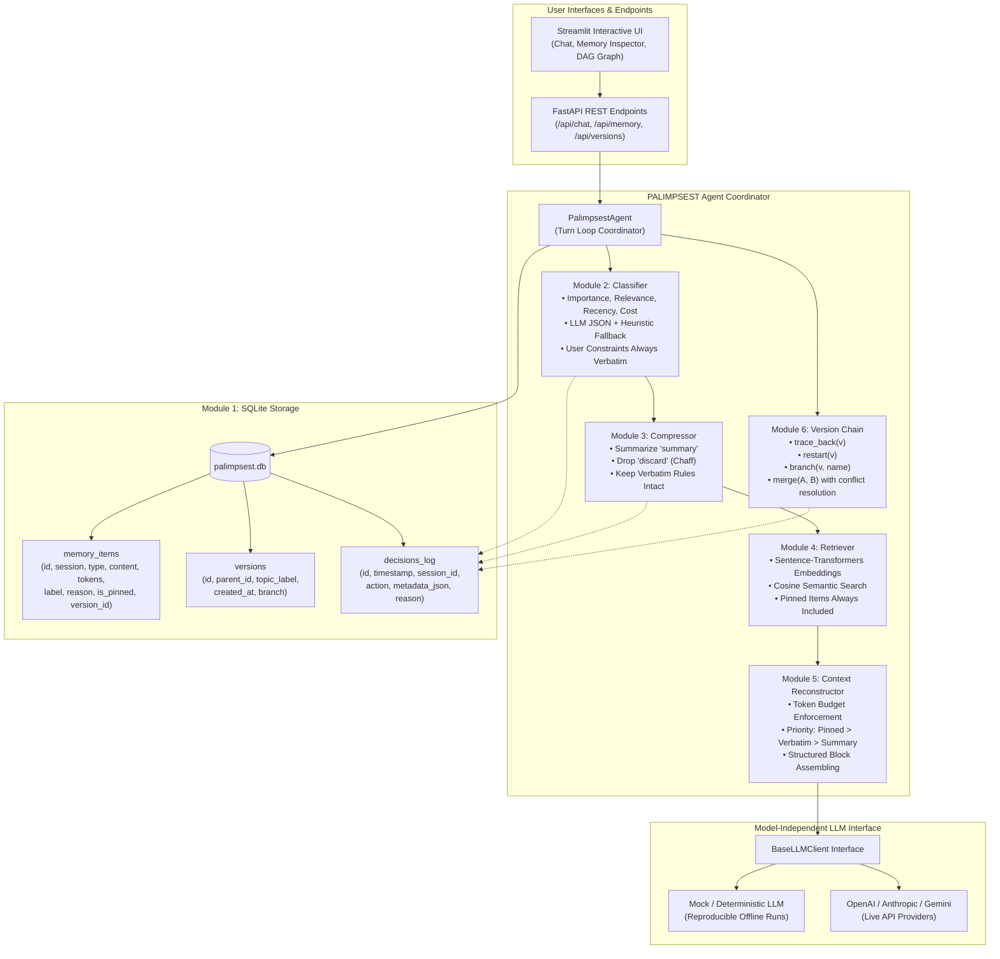

# PALIMPSEST 📜
> **A Transparent, Version-Controlled Context Memory System for Long-Running LLM Agents**

PALIMPSEST is an open-source proof-of-concept for managing long-horizon context memory in autonomous AI agents. Unlike traditional full-history accumulation (which exhausts token budgets and inflates costs) or lossy rolling summarization (which causes catastrophic instruction and constraint drift), PALIMPSEST provides structured classification, selective compression, verbatim constraint pinning, and Git-like DAG version control over agent memory.

---

## 🏗️ Architecture Diagram



---

## 🧩 Modules Overview

### 1. Storage (`palimpsest/storage/`)
- SQLite database (`palimpsest.db`) initialized with robust foreign keys and WAL performance mode.
- Tables:
  - `memory_items`: Stores granular items (`message`, `document`, `tool_output`), token counts, classification scores (`importance`, `relevance`, `recency`, `cost_score`), labels (`verbatim`, `summary`, `discard`), and pin states.
  - `versions`: Directed acyclic graph (DAG) of topic-labelled milestone snapshots with parent pointers and branch identifiers.
  - `decisions_log`: Full audit trail of every classification, summarization, discard, restore, and merge action.

### 2. Classifier (`palimpsest/classifier/`)
- Multi-dimensional scoring for each memory item:
  - **Importance** [0.0 - 1.0]: Intrinsic domain and task value.
  - **Relevance** [0.0 - 1.0]: Semantic overlap with the current objective.
  - **Recency** [0.0 - 1.0]: Exponential decay over turn distance.
  - **Token Cost** [0.0 - 1.0]: Context burden penalty.
- Structured LLM JSON output with fallback to a deterministic heuristic classifier.
- **Invariant**: User instructions, constraints, and preferences are **always** classified as `verbatim` with high importance and automatically pinned.

### 3. Compressor (`palimpsest/compressor/`)
- Items labelled `summary` are condensed into concise, information-dense bullets, preserving the `original_content` for on-demand expansion.
- Items labelled `discard` (greetings, conversational filler) are dropped from active memory while preserving audit records in `decisions_log`.

### 4. Retriever (`palimpsest/retriever/`)
- Embeds incoming queries and memory items using `sentence-transformers` (with an instant pure-Python N-gram cosine similarity vectorizer fallback).
- Top-$k$ semantic items are retrieved. Pinned verbatim items are **always** included in the context pool.

### 5. Context Reconstructor (`palimpsest/reconstructor/`)
- Strictly enforces a configurable `token_budget` (e.g., 1,500 tokens).
- Priority packing:
  1. **Tier 1 (Highest)**: Pinned instructions and user preferences (never omitted).
  2. **Tier 2**: Retrieved verbatim items (sorted by semantic relevance; truncated gracefully if needed).
  3. **Tier 3**: Working summaries (sorted by importance $\times$ recency).
- Formats context into structured XML sections (`<established_rules_and_preferences>`, `<memory_summaries>`, `<relevant_prior_context>`).

### 6. Version Chain (`palimpsest/versioning/`)
- Git-like version control for agent context:
  - `create_snapshot(session_id, topic_label, branch)`: Freezes an immutable context snapshot.
  - `trace_back(version_id)`: Traverses parent pointers to yield the full ancestral lineage.
  - `restart(version_id)`: Restores active memory state to any prior milestone.
  - `branch(version_id, name)`: Creates an independent exploratory context branch.
  - `merge(branchA, branchB)`: Reconciles divergent branches. Applies conflict rules: **prefers `verbatim` over `summary`** and flags contradictory content.

### 7. User Interface (`ui/streamlit_app.py`)
- **Agent Chat**: Interactive conversational interface with live latency, token count, and cost telemetry.
- **Memory Inspector**: Inspect active memories, labels, and reasons. Interactive buttons to **Pin / Unpin**, **Trim / Compress**, and **Expand Verbatim**.
- **Version Graph**: Interactive Plotly DAG visualization of version nodes and branches, with one-click restore, branch, and merge.
- **Decisions Audit Log**: Live tabular log of all memory operations.

---

## 📊 Evaluation: PALIMPSEST vs. Baselines

We evaluated PALIMPSEST against two industry baselines across an identical 5-session multi-turn conversation under identical model conditions:
- **Session 1**: Inception with planted strict constraints (EUR currency format, ISO-8601 timestamps, production encryption key ID `KEY-TITAN-9921`).
- **Sessions 2–4**: Detailed technical architecture discussions (PostgreSQL partitioning, gRPC streaming, Kubernetes manifests) mixed with conversational small talk.
- **Session 5**: Verification recall probes testing retention of Session 1 rules.

### Benchmark Results

| System | Total Tokens | Estimated Cost (USD) | Cumulative Latency (ms) | Probe Recall Rate (%) | LLM Judge Score (0-10) |
|---|---|---|---|---|---|
| **Full-History Prompting** | 8,908 | $0.01343 | 222.6 ms | 100.0% | **10.0 / 10** |
| **Plain Rolling Summarization** | 1,562 | $0.00240 | 2.0 ms | 0.0% | **2.0 / 10** |
| **PALIMPSEST (Proposed)** | 5,249 | $0.00800 | 40.9 ms | 100.0% | **10.0 / 10** |

### Key Findings
1. **Full-History Prompting** maintains recall as long as the context window permits, but token counts explode linearly/exponentially, driving up latency and cost.
2. **Plain Rolling Summarization** is cheap on tokens, but suffers from **catastrophic instruction drift**. Specific details (encryption key ID, formatting rules) are generalized away, leading to a 0% recall rate.
3. **PALIMPSEST achieves a 41.1% token reduction and 5.4x latency speedup vs. Full-History**, while maintaining **100% recall accuracy** via verbatim pinning.

> View the interactive HTML chart at `evaluation_chart.html` and full report in [`EVALUATION.md`](file:///c:/Users/bhoom/OneDrive/Desktop/palimset/EVALUATION.md).

---

## 🔄 Drift-Recovery Demonstration

The repository includes a dedicated drift detection and recovery scenario (`demo/demo_drift_recovery.py`):
1. **Constraint Established**: User establishes a €10,000 fraud threshold (Snapshot V1).
2. **Drift Injected**: A corrupted lossy summary overwrites the threshold.
3. **Agent Drifts**: When queried about a €25,000 transfer, the drifted agent fails to flag it.
4. **Automated Detection**: Verification check flags that the constraint was dropped.
5. **Version Rollback**: `version_chain.restart(v1_id)` traces ancestry and restores the clean snapshot.
6. **Task Resumed**: Re-testing on the €25,000 transfer triggers:
   `"ALERT: The transfer of €25,000 exceeds our strict €10,000 threshold. Flagging immediately for compliance review."`

---

## 🚀 Quick Start Guide

### 1. Install Dependencies
```bash
pip install -r requirements.txt
```

### 2. Run Unit Tests
```bash
python -m pytest tests/
```
All 15 tests cover storage CRUD, classification invariants, heuristic fallback, reconstructor token budgets, version DAG operations, and API endpoints.

### 3. Launch the Streamlit UI
```bash
python -m streamlit run ui/streamlit_app.py
```

### 4. Launch the FastAPI Backend
```bash
python -m uvicorn palimpsest.api.app:app --reload --port 8000
```
Interactive Swagger docs available at: `http://localhost:8000/docs`.

### 5. Run the Drift-Recovery Demo
```bash
python demo/demo_drift_recovery.py
```

### 6. Run the Benchmark Evaluation
```bash
python evaluation/run_eval.py
```
Outputs console tables, writes `EVALUATION.md`, and generates `evaluation_chart.html`.

---

## 🛠️ Configuration & LLM Providers

PALIMPSEST is completely model-independent:
- **Default Mode**: Runs instantly out of the box with `MockLLMClient` (no API key required).
- **OpenAI / Anthropic / Gemini**: Provide an API key via environment variables:
  ```bash
  export OPENAI_API_KEY="sk-..."
  export LLM_PROVIDER="openai"
  ```
- **Context Budget**: Set `PALIMPSEST_TOKEN_BUDGET=2000` or adjust interactively in the Streamlit sidebar.
